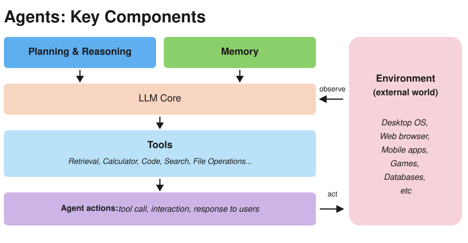

The course teach about how to buiding reliable softwares based on the LLM. This is the first lecture of the Standford CS329Z course. This lecture covers three import parts: agent architecture, compound AI Systems, and key challenges.

## Agent Architecture
An agent is anything that could perceive the enviroments and take actions. It is build from four key components: LLM Core, Planning & Reasoning, Memory, Tools.

### Planning & Reasoning

The reasoning means that the agent's internal actions that update it's own state. And this a is very important for agents, as it's very hard to maintain the observation-action mappings which size could be very large, even unlimited. Another resson is that you can make sure that the agent is align with your goals/values by watching it's reasoning steps. 
COT is a prompting trick that make the LLM to write out intermideate reasoning steps before it gives the final answer. COT has the hallcination problem, as it just do the reasoning without actions.
ReAct mitegate the halucination problem by taking actions. It interleaves the reasoning steps with real actions(tool callings), so it can verify it's reasoning steps by observe the results of the tool callings.
Self consistency is a variant of COT, it generates a diverse set of reasoning path, instead of just one, and aggregate by choosing the most consistent answer in the anwser sets.

### Agent Memory

## Compound AI Systems

## Key Challenges