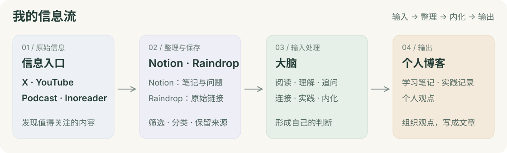

每天，我从 X、YouTube、Podcast 和 Inoreader 接触到不同形式的信息。我想把这些输入串成一条清晰的路径：先整理到 Notion 和 Raindrop，再经过自己的理解与思考，最后输出到个人博客。

## 原始信息：让有价值的内容进入视野

X 上的观点与讨论、YouTube 的视频、Podcast 的对话，以及 Inoreader 中的订阅内容，构成我的信息入口。它们提供线索，也带来新的问题。

这个阶段先做筛选：哪些内容与我正在学习、工作或思考的问题有关？哪些值得花时间继续读下去？

## 整理：给信息一个可以找回的位置

我希望用 Raindrop 和 Notion 承接筛选后的信息。两者的分工可以很简单：

- Raindrop：保存原始链接，按主题归类，方便以后回到原文。
- Notion：整理摘要、摘录和问题，并保留来源，让同一主题的材料聚在一起。

收藏时留下一句“为什么值得保存”，会让以后的自己更容易接上当时的思路。

## 输入处理：经过自己的大脑

整理之后，需要留出真正阅读和思考的时间。我想弄清楚作者在说什么、依据是什么，以及它与已有经验有什么联系。

- 理解：用自己的话复述核心观点。
- 追问：区分事实、观点和仍待验证的假设。
- 连接：把新信息与已有知识、工作中的问题联系起来。
- 内化：通过实践或具体例子，形成自己的判断。

> 能够用自己的话讲清楚，并解释它在什么情况下适用，是我判断自己是否理解的一种方式。

## 输出：写到个人博客

当一个问题逐渐想清楚，就把它写成文章。输出可以是一篇学习笔记、一次实践记录，也可以是围绕一个问题的分析。

写作时，我希望保留三个部分：问题是什么、材料与实践带来了什么发现、我最终形成了什么判断。引用别人的观点时保留来源，有疑问的地方也如实写下来。

这条信息流的终点，是一篇经过自己思考、也能让别人读懂的文章。
